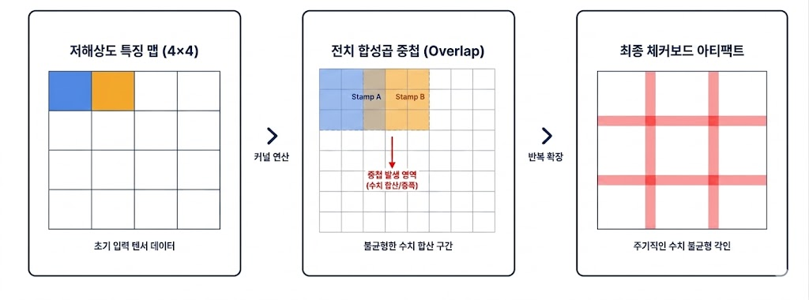
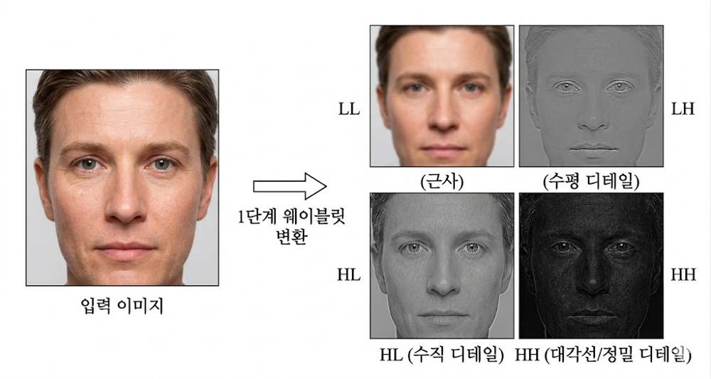
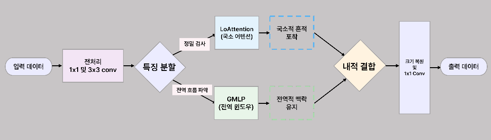
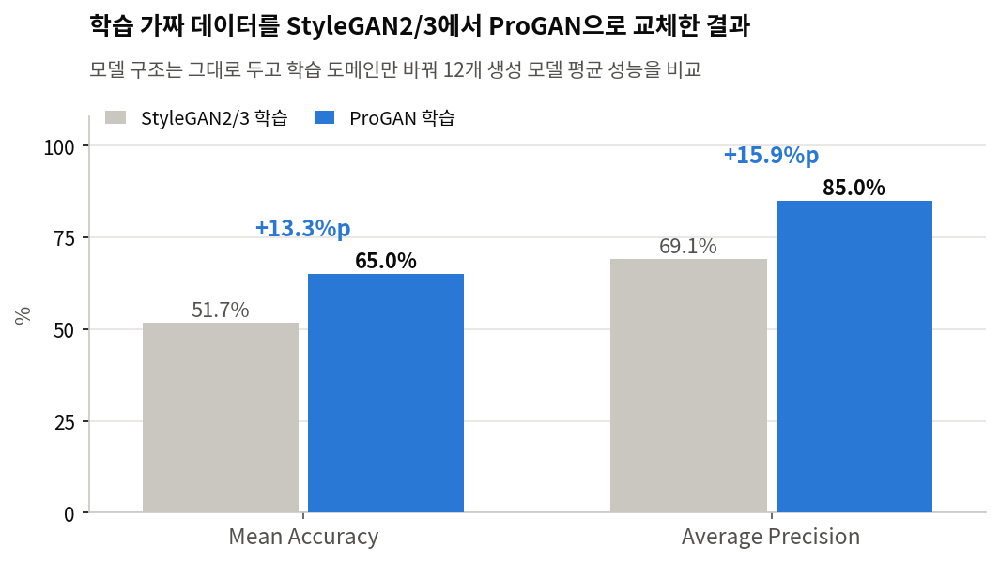
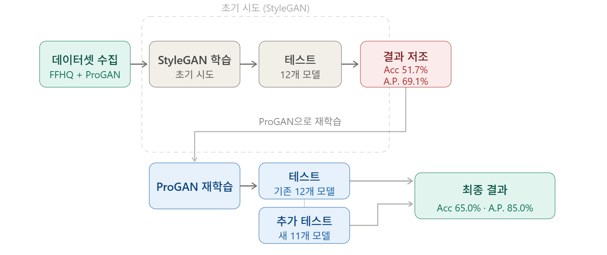
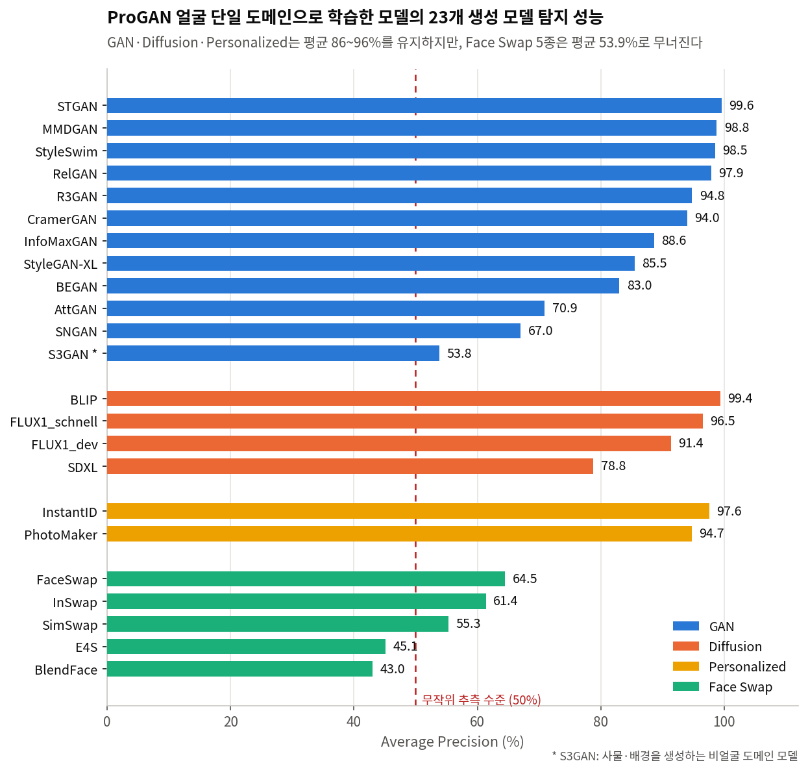
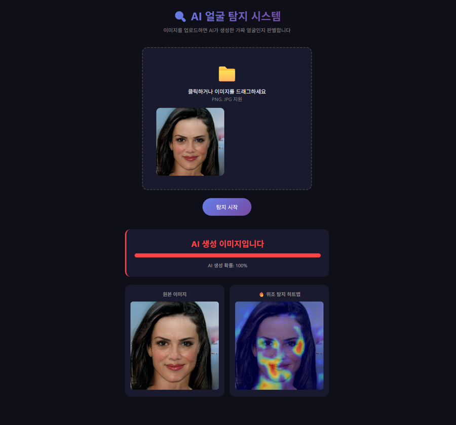
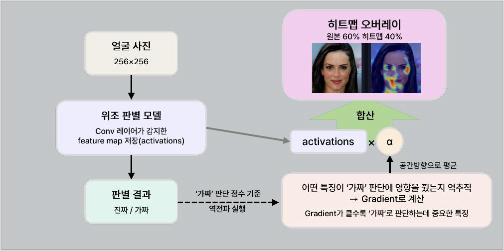

<div align="center">

# 주파수 분석을 이용한 AI 생성 이미지 탐지 연구

**DWT와 FFT를 함께 쓰는 이중 주파수 프레임워크로 23개 AI 생성 모델을 탐지하고,<br/>학습 도메인이 일반화 성능을 어떻게 좌우하는지 실험으로 규명한 학부 연구**

국립한국해양대학교 전자전기정보공학부 데이터사이언스전공 · 지도교수 이정훈 · 2026.05<br/>
팀 Way-V (3인) · 박지민 · 심준용 · **정예성**


[논문 전문](docs/paper.pdf) · [발표자료](docs/presentation.pdf) · [데이터셋 구축 노트북](notebooks/) · [실험 결과](#실험-결과) · [팀 저장소](https://github.com/wayv2026-star/WayV_Detection)

</div>

---

## 한눈에 보기

| 항목 | 내용 |
|---|---|
| 기간 | 2026.03 ~ 2026.05 |
| 문제 | 딥페이크 탐지 모델이 학습한 생성 방식만 "암기"해 새 모델에 안 통하는 Domain Gap |
| 접근 | 이중 주파수 프레임워크 DFFreq(DWT + FFT) 도입 후 학습 도메인을 바꿔 가며 일반화 성능 검증 |
| 학습 | FFHQ 실제 얼굴 40,000장 + ProGAN 생성 얼굴 40,000장 · 90 epochs<br/>초기 실험은 Colab(T4/A100), 최종 학습은 연구실에서 빌린 RTX 3090 |
| 평가 | GAN 12종 · Diffusion 4종 · Face Swap 5종 · Personalized 2종, 총 **23개 생성 모델** |
| **내 역할** | **데이터셋 구축(8만 장 생성·수집) · 선행연구 재현(Frank et al.) · 모델 학습 및 23종 테스트 · 결과 분석 · 프로토타입 개발** · 교내 팀 발표(실험·결과 파트) |

## 문제: 탐지 모델은 "본 적 있는 가짜"만 잡는다

AI 생성 이미지는 육안으로 구별이 거의 불가능해졌습니다. 경찰청 통계상 허위 영상물 범죄는 2021년 156건에서 2024년 297건으로 늘었습니다.

주파수 기반 탐지 연구들이 나왔지만, 공통적으로 **학습에 쓴 생성 모델의 아티팩트 패턴에만 최적화**되는 한계가 있습니다. 저희는 이 문제를 주장이 아니라 **수치로 확인하는 것**부터 시작했습니다.

### 선행연구 3편 재현

동일 조건(학습 800장 / 테스트 400장)에서 직접 돌려 성능을 재현했습니다. **Frank et al.(ICML 2020) 재현은 제가 담당**했습니다.

| 모델 | 학회 | ACC | AUC | 확인한 한계 |
|---|---|:-:|:-:|---|
| Frank et al. | ICML 2020 | 51.0% | 0.519 | DCT 단일 대역에 의존 → 최신 모델은 뚜렷한 아티팩트를 남기지 않음 |
| FreqNet | AAAI 2024 | 52.2% | 0.574 | 주파수를 단순 입력으로만 처리 → 픽셀 간 공간 관계에 취약 |
| DiffusionFake | NeurIPS 2024 | 55.0% | 0.574 | Diffusion 특화 설계 → GAN 계열 탐지 제한적 |
| **DFFreq (채택)** | TIFS 2026 | **60.8%** | — | DWT + FFT 이중 분기 |

세 편 모두 ACC 50~55%로 **사실상 동전 던지기 수준**이었습니다. 단일 주파수 분석과 특정 생성 방식 특화가 일반화를 막는 원인임을 확인하고, DWT와 FFT를 함께 쓰는 DFFreq를 핵심 모델로 선정했습니다.

## 방법: 왜 DWT와 FFT를 같이 쓰는가

### 생성 모델은 업샘플링 과정에서 격자 흔적을 남긴다



GAN이 저해상도 특징 맵을 키우는 과정에서 커널이 겹치며 특정 픽셀에 값이 몰리고, 이 과정이 반복되면 규칙적인 격자 무늬(Checkerboard Artifact)가 남습니다. 육안으로는 보이지 않지만 주파수 영역에서는 측정됩니다. ProGAN처럼 Progressive Growing 방식으로 4×4에서 1024×1024까지 단계적으로 키우는 모델은 해상도 전환마다 이 흔적이 쌓입니다.

### 두 변환이 서로 다른 흔적을 본다

| 변환 | 보는 것 | 역할 |
|---|---|---|
| **DWT** (이산 웨이블릿) | 국소 공간-주파수. LL/LH/HL/HH 중 **HH 고주파 서브밴드** 집중 분석 | 위치 정보를 보존해 눈·코·입 같은 특정 부위의 미세한 위조 흔적을 잡음 |
| **FFT** (고속 푸리에) | 전역 구조. 진폭이 아닌 **위상(Phase)** 정보 | 이미지 전체에 남은 생성 과정의 구조적 흔적을 잡음 |



DWT는 이미지를 저주파(LL)와 세 방향의 고주파(LH·HL·HH)로 분해합니다. LL은 전체 윤곽이라 생성 흔적이 거의 없고, **HH(대각선 고주파)에 미세 노이즈와 연산 지문이 모입니다**. FFT와 달리 "어느 위치에서" 이상이 생겼는지 좌표를 유지한 채 분석할 수 있는 것이 DWT의 강점입니다.

두 분기의 출력은 λ=0.4(DWT) : 0.6(FFT)으로 가중합해 최종 분류합니다. 각 분기에는 RSWAttention 블록이 붙어, 국소 어텐션으로 세부 흔적을 잡고 전역 MLP로 맥락을 유지한 뒤 둘을 결합합니다.



## 처음부터 이 설계였던 건 아니다

초기에는 공개 데이터셋(So-Fake-Set 30,000장)만으로 탐지기를 만들 수 있을지 확인했습니다. 100 epoch 학습 후 검증 정확도는 83.8%였지만, 뜯어 보니 **실제 이미지를 잘 맞혀서 생긴 착시**였습니다.

| 구간 | ACC | 실제 정확도 | **가짜 정확도** |
|---|:-:|:-:|:-:|
| 검증 (So-Fake-Set) | 83.8% | 97.5% | **49.4%** |
| 교차 테스트 (FaceForensics++ · DeepDetect) | 77.0% | 97.3% | **55.9%** |

정작 탐지해야 할 가짜는 절반 수준밖에 걸러내지 못했습니다. 라벨이 뒤집힌 설정 실수가 아닌지 확인하려고 진짜·가짜 폴더를 서로 바꿔 넣고 다시 돌려 본 뒤, 모델의 실제 한계임을 확인했습니다.

여기서 **생성 방식이 뒤섞인 데이터로는 공통 아티팩트를 학습할 수 없다**고 판단하고, 도메인을 얼굴로 좁히고 생성 모델을 ProGAN으로 통제한 데이터셋을 직접 만드는 쪽으로 방향을 바꿨습니다. ([00_cross_dataset_baseline](notebooks/00_cross_dataset_baseline.ipynb))

## 데이터셋 구축

논문에는 "FFHQ 40,000장 + ProGAN 40,000장"으로 한 줄 적혀 있지만, 이 8만 장은 기존 데이터셋을 받아 쓴 것이 아니라 **직접 생성하고 수집한 것**입니다. 과정은 [`notebooks/`](notebooks/)에 정리했습니다.

| 구분 | 구성 | 방법 |
|---|---|---|
| 학습 Real | FFHQ 40,000장 | HuggingFace 스트리밍 수집 (이어받기 지원) |
| 학습 Fake | ProGAN 40,000장 | 사전학습 ProGAN으로 **직접 생성** (약 1시간 25분, 12.6GB) |
| 테스트 | 23개 모델 × (Real 2,000 / Fake 2,000) | 공개 데이터셋 수집 + Diffusion 3종 직접 구축 |

데이터를 만들면서 신경 쓴 지점들입니다.

- **학습/테스트 분리** — 테스트용 Real도 FFHQ에서 가져와야 했는데 학습 데이터와 겹치면 성능이 부풀려집니다. 스트리밍에 `skip(40000).take(12000)`을 적용해 학습에 쓴 앞 4만 장을 건너뛰고 그다음 구간만 테스트용으로 썼습니다.
- **무손실 PNG 통일** — 이 연구는 DWT·FFT로 고주파 아티팩트를 보는데, JPEG 재압축은 바로 그 고주파를 깎아냅니다. 전 과정을 PNG로 통일했습니다.
- **1:1 균형** — 모델마다 Real·Fake를 2,000장씩 맞추고 무작위 샘플링해 특정 구도로 치우치지 않게 했습니다.

## 실험 결과

### 핵심 실험: 학습 도메인을 바꾸자 성능이 뛰었다

초기에는 StyleGAN2/3 생성 이미지로 학습했지만 Mean Acc 51.7%에 그쳤습니다. **StyleGAN의 Style Mixing과 AdaIN이 아티팩트를 해당 모델 고유 패턴으로 만들어** 다른 생성 모델에 일반화되지 않는다고 판단하고, 업샘플링 아티팩트가 규칙적으로 남는 **ProGAN으로 학습 데이터를 교체**했습니다.



모델 구조는 그대로 두고 **학습에 쓴 가짜 데이터만 바꿨는데 Mean Acc +13.3%p, AP +15.9%p** 올랐습니다. 탐지 성능이 모델 구조만큼이나 학습 도메인 선택에 좌우된다는 것을 보여주는 결과입니다.



### 23개 생성 모델 탐지 성능



| 카테고리 | 모델 수 | 평균 ACC | 평균 AP | 해석 |
|---|:-:|:-:|:-:|---|
| GAN | 12종 | 72.3% | **86.0%** | 학습 도메인과 같은 계열. STGAN 99.6%, MMDGAN 98.8% |
| Diffusion | 4종 | 70.5% | **91.5%** | **GAN 하나로만 학습했는데 Diffusion까지 탐지** — 이중 주파수 분기의 일반화 능력 |
| Personalized | 2종 | 93.1% | **96.2%** | InstantID·PhotoMaker 모두 얼굴 기반 생성 → 얼굴 특화 학습의 강점 |
| Face Swap | 5종 | 47.8% | **53.9%** | 전 카테고리 중 최저 |

### 안 되는 경우를 분석했다

성능이 낮게 나온 두 경우의 원인을 구조적으로 규명한 것이 이 연구에서 가장 공들인 부분입니다.

**Face Swap (AP 53.9%)** — Face Swap은 얼굴 영역만 합성하고 배경은 원본을 유지하는 방식이라, **아티팩트가 주로 얼굴 바깥 경계면에 생깁니다**. 저희 모델은 얼굴 내부 영역의 아티팩트 패턴만 학습했기 때문에 경계 아티팩트를 탐지하지 못합니다. 원 논문은 car·cat·chair·horse 다중 도메인으로 학습해 비얼굴 영역 패턴까지 익혔기에 Acc 88.2%를 기록했습니다.

**S3GAN (AP 53.8%)** — semantic segmentation map을 입력받아 자동차·건물 등 **사물**을 생성하는 모델입니다. 얼굴만 학습한 저희 모델과 도메인이 완전히 불일치해 탐지에 실패했습니다.

**AttGAN(논문 99.8% → 70.9%), SNGAN(99.6% → 67.0%)** — 이 모델들은 Spectral Normalization 같은 학습 안정화 기법으로 업샘플링 아티팩트가 억제됩니다. 얼굴 도메인에 집중한 저희 학습 설정에서는 성능 격차가 원 논문보다 크게 나타났습니다.

> 얼굴 단일 도메인 학습은 **얼굴 생성 모델 탐지에서는 논문의 다중 도메인 학습만큼 효과적이지만, 도메인을 벗어나면 급격히 무너진다**는 트레이드오프를 실험으로 확인했습니다.

## 프로토타입

판정 결과만 주면 사용자가 신뢰하기 어렵기 때문에, **Grad-CAM으로 모델이 위조로 판단한 영역을 히트맵으로 시각화**했습니다.



| 확률 | 판정 |
|---|---|
| 90% 이상 | AI 생성 이미지입니다 |
| 70 ~ 90% | AI 생성 이미지로 의심됩니다 |
| 30 ~ 70% | 판단이 어렵습니다 |
| 30% 이하 | 실제 이미지입니다 |



히트맵은 마지막 Conv 레이어의 feature map을 저장하고(순전파), '가짜' 판단 점수로 역전파해 그래디언트를 구한 뒤, 공간 방향 평균으로 채널 중요도 α를 계산해 `activations × α`를 합산하는 Grad-CAM 방식입니다. AI 생성 이미지에서는 눈가·피부 경계·입술처럼 생성 흔적이 남기 쉬운 부위에 히트맵이 집중됩니다.

## 한계와 다음 단계

| 한계 | 원인 | 개선 방향 |
|---|---|---|
| 얼굴 단일 도메인 학습 | FFHQ + ProGAN 얼굴 데이터만 사용 | FFHQ와 LSUN 등 사물 데이터를 섞은 **멀티 도메인 학습** |
| Face Swap 경계 아티팩트 미탐지 | 얼굴 내부 패턴만 학습 | DWT 분기 가중치(λ=0.4)를 높여 위치 정보 활용 강화 |
| 분류 임계값 고정 | 기본값 0.5 사용 | 검증 단계에서 **최적 임계값 탐색 후 재설정** |

## 저장소 구성

```
.
├── README.md
├── notebooks/              데이터셋 구축·학습 노트북 (직접 작업한 부분)
├── docs/
│   ├── paper.pdf           논문 전문 (16p)
│   └── presentation.pdf    발표자료 (34p)
└── figures/                방법 설명 도식, 결과 차트, 프로토타입 화면
```

전체 학습·추론 코드와 모델 가중치는 팀 저장소 [wayv2026-star/WayV_Detection](https://github.com/wayv2026-star/WayV_Detection)에 공개되어 있습니다. 이 저장소는 **제가 담당한 실험과 결과 분석을 중심으로 정리한 개인 포트폴리오용**입니다.

## 참고문헌

1. Yan, J., et al. (2026). *Dual Frequency Branch Framework with Reconstructed Sliding Windows Attention for AI-Generated Image Detection.* IEEE TIFS. — [원 구현](https://github.com/HorizonTEL/DFFreq-main) · [arXiv](https://arxiv.org/abs/2501.15253)
2. Frank, J., et al. (2020). *Leveraging Frequency Analysis for Deep Fake Image Recognition.* ICML 2020.
3. DiffusionFake (2024). *Enhancing Generalization in Deepfake Detection via Guided Stable Diffusion.* NeurIPS 2024.
4. FreqNet (2024). *Frequency-Aware Deepfake Detection: Improving Generalizability through Frequency Space Learning.* AAAI 2024.
5. Wang, S.-Y., et al. (2020). *CNN-generated images are surprisingly easy to spot... for now.* CVPR 2020. — [arXiv:1912.11035](https://arxiv.org/abs/1912.11035)
6. Wong, K., et al. (2025). *ADCD-Net: Robust Document Image Forgery Localization.* — [arXiv:2507.16397](https://arxiv.org/abs/2507.16397)
7. 경찰청 (2024). 허위 영상물 범죄 발생 현황 통계.

---

<sub>탐지 모델 구현체는 Yan et al.(TIFS 2026)의 공개 코드를 사용했으며, 본 연구의 기여는 선행연구 재현 검증, 학습 데이터셋 구축, 학습 도메인 설계와 재학습, 23개 생성 모델에 대한 평가 및 원인 분석, 프로토타입 구현입니다. 논문 본문의 프로토타입 예시 이미지는 StyleGAN으로 생성된 가상 인물입니다.</sub>
